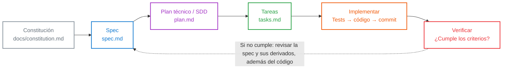
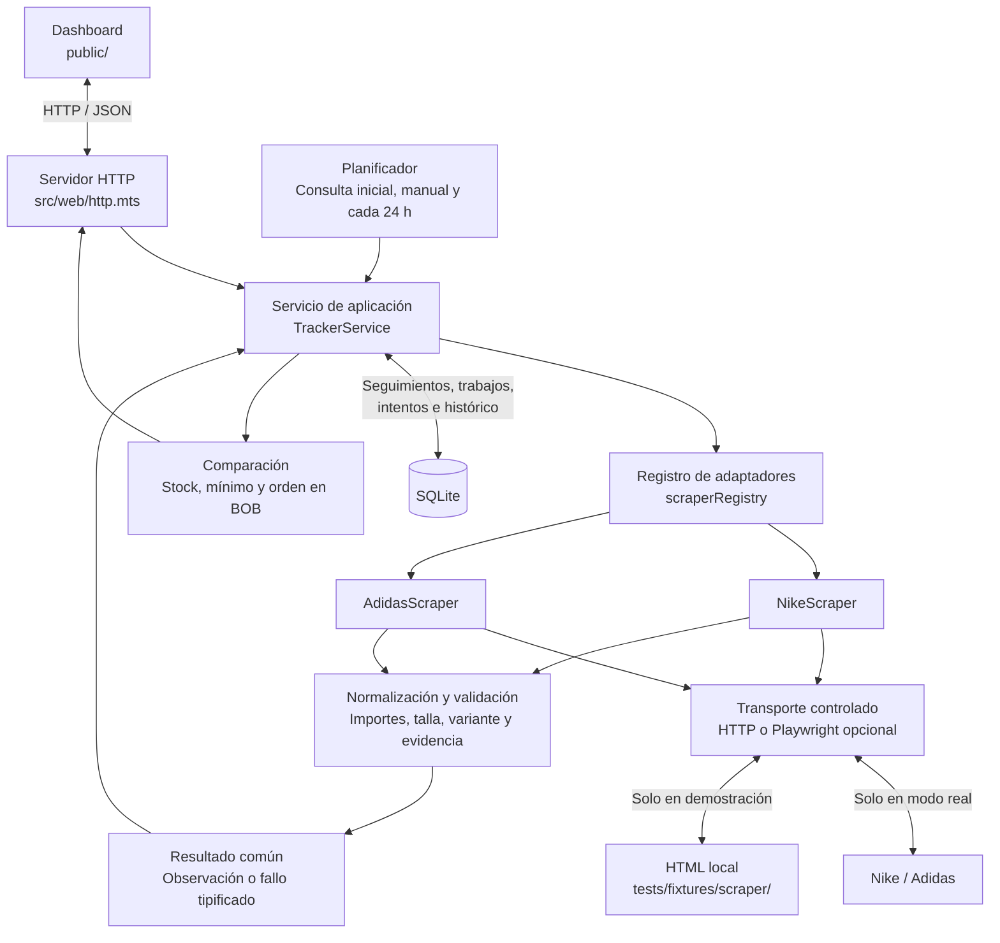

# Price Tracker & Comparator · En su punto

Aplicación web de uso personal para seguir calzado de Nike y Adidas por **URL, color y talla en cm**, conservar sus precios y comparar las variantes disponibles en bolivianos.

El proyecto utiliza **Specification-Driven Development (SDD)**: la constitución establece las reglas, la especificación define el comportamiento y el plan lo convierte en decisiones técnicas y tareas verificables.

**Estado actual:** el modo de demostración permite probar el recorrido completo con HTML local. La compatibilidad con páginas reales depende del mercado, los datos publicados y los bloqueos de las tiendas. En la comprobación realizada, Adidas respondió con HTTP 403; la validación completa del MVP con ambas tiendas sigue pendiente.

## El flujo SDD

El siguiente diagrama reproduce la secuencia y los colores de la referencia: **Constitución → Spec → Plan → Tareas → Implementar → Verificar**.



| Etapa | Documento o evidencia | Función |
| --- | --- | --- |
| Constitución | [constitution.md](docs/constitution.md) | Define los seis principios innegociables: stack mínimo, scrapers intercambiables, fallos y límites, tests, histórico e idiomas. |
| Spec | [spec.md](specs/001-price-tracker-mvp/spec.md) | Explica el qué y el porqué mediante historias, RF-1 a RF-7 y criterios de aceptación EARS. |
| Plan | [plan.md](specs/001-price-tracker-mvp/plan.md) | Define módulos, modelo de datos, contrato del scraper, decisiones técnicas y estrategia de tests. |
| Tareas | [tasks.md](specs/001-price-tracker-mvp/tasks.md) | Desglosa el trabajo en unidades de 30–45 minutos con RF y «Hecho cuando». |
| Implementar | [src/](src/), [public/](public/) y [tests/](tests/) | Convierte los requisitos en comportamiento ejecutable y pruebas. |
| Verificar | Tests, revisión de criterios y comprobaciones de tiendas | Contrasta la implementación con lo especificado y registra las limitaciones. |

El flujo se aplica por funcionalidad. Si cambia una regla o aparece una ambigüedad, se actualizan la especificación y sus documentos derivados antes de dar el trabajo por aceptado. Si la regla ya es correcta y existe un defecto de implementación, se corrige el código y se añade la prueba correspondiente. Pasar tests con fixtures no demuestra por sí solo compatibilidad con el HTML actual de las tiendas.

El tablero de tareas conserva pendientes y no constituye una auditoría actualizada de toda la implementación. La incorporación inicial al repositorio se realizó en un único commit; el esquema de commits por tarea es el flujo de trabajo previsto para las siguientes iteraciones.

## Arquitectura de la aplicación

Se utiliza una **aplicación modular en un único proceso Node.js**, con TypeScript, SQLite y una interfaz en HTML, CSS y JavaScript. El servidor HTTP, el planificador y el motor de consultas comparten proceso. No se necesitan microservicios, Redis ni un framework de interfaz.



El diagrama representa responsabilidades: el planificador y la comparación están implementados dentro de `TrackerService`, no son servicios desplegados por separado. En demostración, el servicio sustituye el acceso de red por fixtures, manteniendo los adaptadores, la validación y la persistencia.

| Componente | Ubicación | Responsabilidad | RF |
| --- | --- | --- | --- |
| Arranque | [src/server.mts](src/server.mts) | Inicia el servidor en `127.0.0.1`, selecciona modo y base de datos y gestiona el cierre. | Soporte transversal |
| Dashboard | [public/](public/) | Registro, seguimientos, tabla de ofertas, histórico y mensajes en español. Consulta el estado periódicamente. | RF-1, RF-3 a RF-7 |
| Servicio HTTP | [src/web/http.mts](src/web/http.mts) | Sirve la interfaz, valida las solicitudes y expone las operaciones de la aplicación. | RF-1 a RF-7 |
| Servicio de aplicación | [src/app/service.mts](src/app/service.mts) | Coordina registro, ejecución, consultas diarias, reintentos, escenarios de demostración y comparación. | RF-1 a RF-6 |
| Contrato base | [src/scraping/base-scraper.mts](src/scraping/base-scraper.mts) | Define `describe`, `resolveProduct`, `fetchProducts`, contexto, resultados y errores comunes. Es un contrato TypeScript; no ejecuta consultas por sí mismo. | RF-1, RF-2, RF-4 |
| Adaptadores | [src/scraping/stores.mts](src/scraping/stores.mts) | Extraen datos estructurados con Cheerio. Nike también puede comprobar equivalencias en la guía oficial enlazada por el producto. | RF-1, RF-2, RF-4 |
| Transporte | [src/scraping/transport.mts](src/scraping/transport.mts) | Obtiene HTML por HTTP; ofrece renderizado opcional con Playwright, cancelación y restricciones de acceso. | RF-2, RF-4 |
| Normalización | [src/domain/normalization.mts](src/domain/normalization.mts) | Valida URLs y observaciones, interpreta importes y tallas y aplica la conversión admitida. | RF-1, RF-2, RF-5 a RF-7 |
| Persistencia | [src/storage/store.mts](src/storage/store.mts) | Aplica migraciones y transacciones y conserva trabajos, intentos y observaciones. | RF-1, RF-3 a RF-6 |
| Políticas | [src/config.mts](src/config.mts) | Centraliza plazos, pausas, reintentos y ajustes por dominio. | RF-3, RF-4 |

### Cómo se procesa un producto

1. El usuario envía una URL regional admitida, el color exacto publicado y una talla en cm.
2. La aplicación valida la selección, detecta duplicados y guarda el seguimiento con su consulta inicial en una transacción.
3. El planificador reclama un trabajo disponible. Una reserva temporal evita que dos ejecuciones procesen el mismo seguimiento a la vez.
4. El adaptador obtiene el HTML mediante el transporte controlado y busca evidencia de la combinación exacta. Una talla seleccionable o un botón de compra genérico no bastan para confirmar stock.
5. La normalización comprueba identidad, importes, moneda, talla y evidencia. Un resultado no verificable se comunica como fallo y no crea precios ficticios.
6. Una consulta válida añade una observación al histórico, aunque el precio sea idéntico al anterior. Los intentos fallidos se registran por separado.
7. La comparación selecciona variantes con stock confirmado, valoración en BOB y sin un fallo posterior. Las ordena por precio ascendente; los desempates usan fecha más reciente, tienda, nombre e identificador.

Las consultas diarias se anclan al registro. Actualizar manualmente no desplaza ese calendario. Tras una interrupción, los periodos vencidos se agrupan en una consulta de recuperación: no se inventan observaciones del tiempo en que el servicio estuvo apagado.

### Persistencia e histórico

Las relaciones principales son **tienda → mercado → producto → variante** y **seguimiento → trabajos → intentos → observaciones**. SQLite también conserva la configuración monetaria y los aplazamientos por dominio.

Cada observación guarda una instantánea de identidad, precios, moneda, stock, evidencia y fecha UTC. Las transacciones y restricciones evitan escrituras parciales; los triggers impiden modificar o eliminar observaciones. Los importes se calculan como enteros en unidades monetarias menores, usando `bigint`, y se serializan como cadenas cuando se devuelven por JSON.

La tasa configurada es **1 USD = 10 BOB**, indicada manualmente por el usuario. No es una cotización oficial ni se actualiza desde un proveedor externo. El importe original y la referencia de conversión quedan conservados. Los precios publicados en BOB se utilizan directamente; otras monedas permanecen visibles en el histórico, sin entrar en la clasificación BOB.

El mínimo histórico se calcula sobre observaciones comparables **con stock disponible**, para la misma variante. Los datos se guardan en UTC y se presentan en `America/La_Paz`.

### Fallos y límites de consulta

La configuración inicial admite un trabajo activo por dominio, hasta cuatro dominios en paralelo, pausa de 5 segundos, plazo de petición de 15 segundos y plazo total del intento de 60 segundos. Los fallos transitorios tienen hasta dos reintentos adicionales con backoff de 5 y 15 segundos, más una variación aleatoria acotada.

Un captcha o bloqueo no provoca reintentos automáticos dentro del mismo trabajo. Una respuesta 429 aplaza el dominio respetando `Retry-After`; sin una referencia válida se aplica una espera de 15 minutos. Los cambios de HTML se muestran como incompatibilidad, conservando el último dato válido y su fecha. Los valores concretos se encuentran en [config.mts](src/config.mts).

### Cómo añadir una tienda

Se implementa un adaptador que cumpla `BaseScraper`, se registra en `scraperRegistry`, se amplían los dominios y formatos de URL admitidos y se añaden fixtures y pruebas. Si la tienda necesita otras reglas de acceso, se configura su política por dominio. El contrato común permite mantener el motor de ejecución y el dashboard sin lógica específica de la nueva marca.

## Ejecutar el proyecto

Requisito: **Node.js 24.14.0 o superior**, con npm. Desde la raíz del proyecto:

```bash
npm ci
npm run demo
```

Abre **http://localhost:3000** y pulsa **Cargar ejemplos**. En una base de demostración nueva aparecen tres seguimientos y dos ofertas disponibles: Adidas a 795 BOB y Nike a 850 BOB, con la tasa manual configurada.

Para comprobar el recorrido:

1. Abre **Mejores ofertas** y comprueba el orden por precio.
2. En el Nike negro, selecciona **Bajada de precio**: pasa a 650 BOB y se añade una observación al histórico.
3. Abre el histórico para consultar las fechas y la referencia de cambio.
4. Selecciona **Captcha / bloqueo**: se conserva el precio anterior y el producto sale de las ofertas elegibles.
5. Prueba **HTML alterado**, **Sin stock** o **Límite (2 minutos)** y revisa los estados en **Todos**.

La demostración solo reconoce los productos de ejemplo; no consulta Nike ni Adidas. Sus URLs identifican ejemplos ficticios, no ofertas reales. La base persiste entre ejecuciones, por lo que las observaciones anteriores seguirán apareciendo al volver a abrirla.

Para usar URLs reales, detén la demostración con `Ctrl+C` y ejecuta:

```bash
npm start
```

Introduce un enlace de producto admitido y copia el color exacto tal como lo publica la tienda. La talla debe estar explícitamente en cm o poder vincularse mediante una equivalencia verificada. Se requiere conexión a Internet; un bloqueo o una página no compatible aparecerá como tal en la interfaz.

Para habilitar el renderizado opcional de páginas dinámicas en macOS/Linux:

```bash
npx playwright install chromium
DYNAMIC_SCRAPING=1 npm start
```

Playwright solo se intenta ante una página incompatible y con esa opción activada; no se utiliza para evadir bloqueos. La descarga del navegador es necesaria para ese modo y para las pruebas de interfaz, no para la demostración ni los tests habituales.

| Configuración | Valor predeterminado | Uso |
| --- | --- | --- |
| `PORT` | `3000` | Puerto del servidor local. |
| `DB_PATH` | `data/demo.sqlite` o `data/tracker.sqlite` | Ruta de la base, según el modo. Permite elegir otra ubicación. |
| `DYNAMIC_SCRAPING` | Desactivado | El valor `1` habilita el intento de renderizado dinámico. |
| `CHROMIUM_EXECUTABLE` | Navegador gestionado por Playwright | Ruta opcional a un ejecutable Chromium ya instalado. |

El servidor debe permanecer encendido para ejecutar consultas diarias; cerrar la pestaña no lo detiene. Las bases de demostración y de uso real están separadas. `node_modules/`, `data/` y los archivos SQLite están excluidos de Git.

## Verificación

```bash
# Comprobación estricta de TypeScript y tests del contrato, dominio, servicio y HTTP
npm run check

# Solo tests de la aplicación, con acceso externo bloqueado
npm test

# Prueba automatizada del dashboard en Chromium
npx playwright install chromium
npm run test:ui
```

Los tests automáticos usan [fixtures HTML](tests/fixtures/scraper/) y transportes simulados. Las pruebas HTTP levantan un servidor en localhost; las de interfaz interceptan el tráfico para permitir únicamente la aplicación local.

La última ejecución local de `npm run check` aprobó **31 tests** y la comprobación de tipos. Las pruebas automatizadas de navegador están preparadas, pero su ejecución local no quedó validada. El workflow [check.yml](.github/workflows/check.yml) configura tipos, tests e interfaz para GitHub Actions; su resultado debe consultarse en la pestaña **Actions** del repositorio.

| Requisito | Evidencia automatizada principal |
| --- | --- |
| RF-1 · Registro y variantes | [service.test.mjs](tests/app/service.test.mjs), [normalization.test.mjs](tests/app/normalization.test.mjs) y [http.test.mjs](tests/app/http.test.mjs). |
| RF-2 · Precio y stock | [adapters.test.mjs](tests/app/adapters.test.mjs) y [resilience.test.mjs](tests/app/resilience.test.mjs). |
| RF-3 · Consultas iniciales, diarias y manuales | [service.test.mjs](tests/app/service.test.mjs) y [resilience.test.mjs](tests/app/resilience.test.mjs), con reloj controlado. |
| RF-4 · Fallos y límites | [adapters.test.mjs](tests/app/adapters.test.mjs), [normalization.test.mjs](tests/app/normalization.test.mjs), [service.test.mjs](tests/app/service.test.mjs) y [resilience.test.mjs](tests/app/resilience.test.mjs). |
| RF-5 · Histórico | [service.test.mjs](tests/app/service.test.mjs): persistencia, reapertura e inmutabilidad. |
| RF-6 · Comparación | [service.test.mjs](tests/app/service.test.mjs) y [resilience.test.mjs](tests/app/resilience.test.mjs): mínimos, exclusiones y desempates. |
| RF-7 · Presentación | [http.test.mjs](tests/app/http.test.mjs) comprueba parte de la interfaz servida; [dashboard.test.mjs](tests/ui/dashboard.test.mjs) prepara la verificación de interacción y presentación en navegador. |

Estas evidencias verifican escenarios concretos y no equivalen a aceptación completa de todos los RF. Permanecen pendientes la validación de extremo a extremo con ambas tiendas reales, la ejecución confirmada de los tests de navegador y la sincronización de todas las decisiones implementadas con las dudas abiertas de la especificación.
